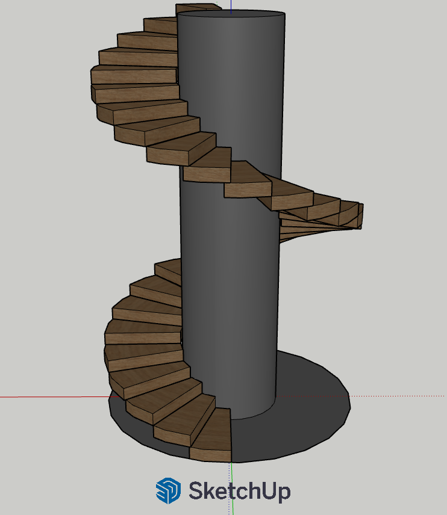
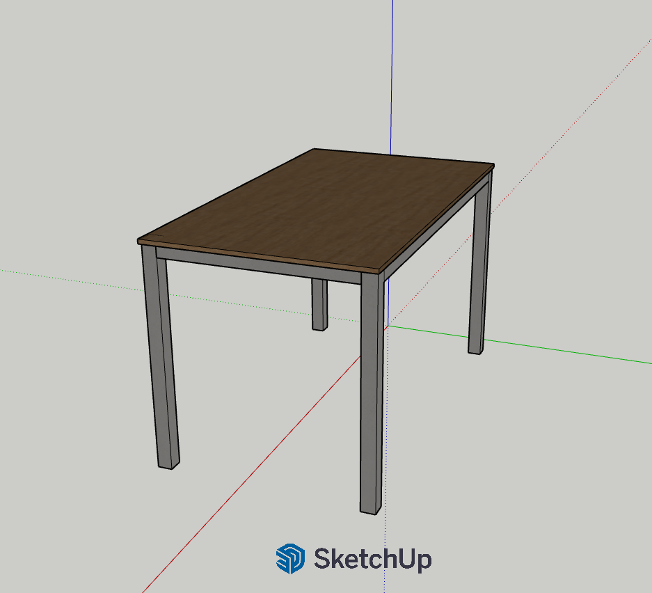
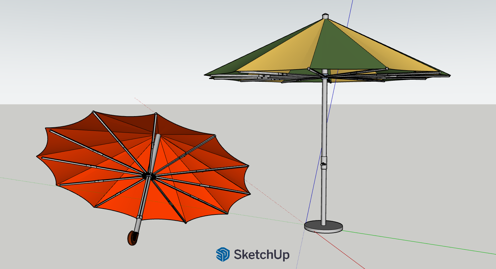

# 3D School Design Portfolio (SketchUp)

Welcome to my 3D modeling portfolio repository! Here you can find a collection of school projects created using **SketchUp**, focusing on structural design, proportions, and geometry.

---

## Projects Overview

### 1. Spiral Staircase (`Stairs_school_project.skp`)
* **Description:** A detailed model of a modern spiral staircase featuring a central supporting pillar and wooden steps.
* **[View / Download Model Here](https://app.sketchup.com/share/tc/europe/IY41bKsOTjg?source=web&stoken=A107Qvixj8KZw6MsukzKu7rK2hEzzWAeX-P8jrfxeGs0i5FYv4EJ0rEOJ0SFP7MX)**

### 2. Modern Table 
* **Description:** A minimalist furniture project showcasing clean lines, a wooden tabletop, and structural metal-style legs.
* **[View / Download Model Here](https://app.sketchup.com/share/tc/europe/S5bhq_zdsgc?source=web&stoken=Wi308cy8sR_fHuwWbSzCXS0D5iVe00YwPRaL2u9jEKnyR8B-YjyuK0dRnkjV_5sS)**

### 3. Open & Closed Umbrellas (Parasols)
* **Description:** A complex mechanism study modeling umbrellas in both open and closed states, featuring multi-panel colored fabric and detailed rib structures[cite: 5].
* **[View / Download Model Here](https://app.sketchup.com/share/tc/europe/K9LzcEg0N4o?source=web&stoken=l9VZoW_fYnhRQ_4plFeTCqgMvNKNz0cFnc25kVMsepcINetqU09tawYwjZYR9hHH)**

---

## Software Used
* **SketchUp** – For 3D modeling, geometry, and component design.

---
